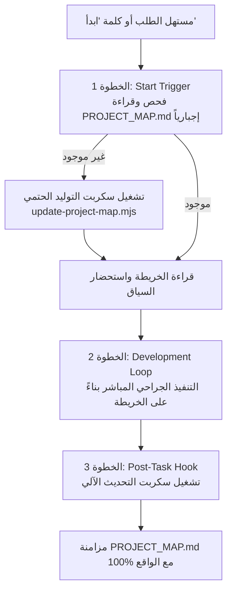

# بروتوكول خريطة المشروع الحتمية (Project Map Autonomous Protocol)
## مهارة التوجيه الشامل والاستحضار اللحظي للسياق ("ابدأ")

هذه المهارة هي البروتوكول التشغيلي الدائم لوكيل الذكاء الاصطناعي (AI Agent). هدفها الأساسي هو **إلغاء التخبط والمسح العشوائي لملفات المشروع**، وتمكين الوكيل من معرفة أدق تفاصيل أي مشروع كان في أجزاء من الثانية عبر وثيقة `PROJECT_MAP.md`.

---

## 1. محفزات التفعيل (Activation Triggers)
يتم تفعيل هذه المهارة حتمياً في الحالات الآتية:
1. **قول المستخدم كلمة "ابدأ" (أو "Start"):** إشارة البدء الفوري الصريحة.
2. **بدء أي محادثة أو طلب برمجي جديد:** في مستهل العمل على أي ميزة، إصلاح خلل، أو استفسار معماري.
3. **افتتاح مشروع جديد أو غير مألوف:** لإنشاء خريطة شاملة فورا.

---

## 2. الخطوات الثلاث الذكية والحتمية (The 3-Step Lifecycle)



### الخطوة الأولى: محفز البداية (Start Trigger - Mandatory Context Grounding)
1. **الفحص والقراءة الإلزامية:**
   - يقوم الوكيل فوراً وبشكل إجباري بفحص وجود ملف `PROJECT_MAP.md` في جذر المشروع وقراءته.
   - يُحظر تماماً تخمين بنية المشروع أو مسح الملفات عشوائياً إذا كان الملف موجوداً.
2. **الإنشاء التلقائي إن لم يكن موجوداً:**
   - إذا لم يكن الملف موجوداً، يُمنع التخمين نهائياً، ويتم تشغيل أمر الفحص الحتمي فوراً:
     ```bash
     npm run map:update
     # أو مباشرة:
     node scripts/update-project-map.mjs
     ```
   - قراءة الملف الناتج فوراً لاستحضار كامل السياق المعماري، المكدس التقني، والخدمات المتاحة.

---

### الخطوة الثانية: حلقة التطوير الجراحي (Development Loop)
1. **الاستناد إلى الخريطة:**
   - التوجه مباشرة إلى الملف أو المكون المعني بالتعديل بناءً على الروابط والمواقع الموضحة في الخريطة دون الحاجة للبحث في عشرات الملفات غير ذات الصلة.
2. **الامتثال للقواعد الصارمة:**
   - الالتزام بقاعدة سقف الـ 300 سطر للملف الواحد.
   - احترام ترويسة السطر الأول وتنسيق الأرقام الإنجليزية (0-9).
   - كتابة وتحديث الاختبارات التخصصية المقابلة لكل ميزة.

---

### الخطوة الثالثة: خطاف ما بعد الإنجاز (Post-Task Hook - Auto-Sync)
قبل أن يختم الوكيل رده أو ينهي مهمته، يجب عليه حتمياً تشغيل سكربت المزامنة الآلي:
```bash
npm run map:update
# أو
node scripts/update-project-map.mjs
```
- يقوم السكربت بإعادة فحص الملفات الجديدة، المكونات، والخدمات التي تم إنشاؤها أو تعديلها، وتحديث الجداول والإحصائيات وتاريخ التحديث داخل `PROJECT_MAP.md`.
- يضمن ذلك أن `PROJECT_MAP.md` يظل حياً ومتزامناً بنسبة 100% مع واقع الكود، وجاهزاً للطلب القادم.

---

## 3. العمل عبر أي مكدس أو مشروع (Cross-Stack Universality)
المهارة مصممة لتكون عامة وقابلة للتطبيق على أي لغة أو بيئة:
- **Node.js / React / Vue / Next.js:** قراءة `package.json` واكتشاف الأطر والمكتبات.
- **Flutter / Dart:** قراءة `pubspec.yaml` ومسارات `lib/`.
- **Python (FastAPI / Django / Flask):** قراءة `requirements.txt` أو `pyproject.toml`.
- **PHP / Laravel / Symfony:** قراءة `composer.json` ومسارات `app/`.
- **Go / Rust / C#:** قراءة ملفات الإعدادات النمطية وتوثيق الحزم.
