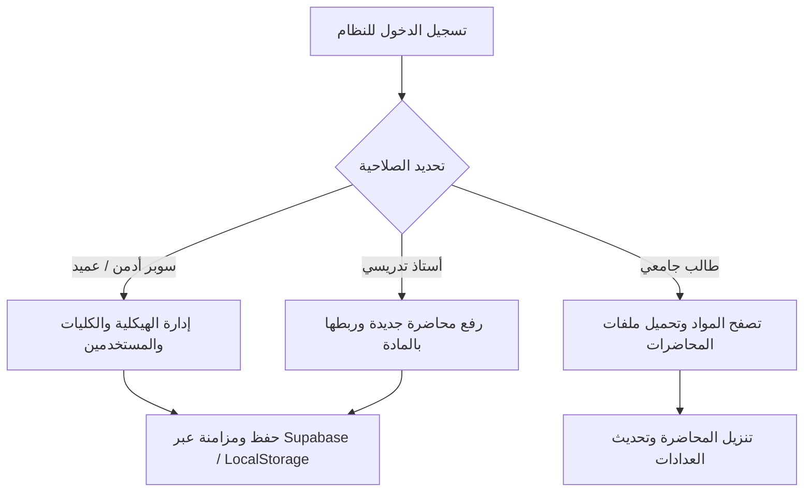

# وثيقة مواصفات وتشغيل المنتج الأدنى القابل للإطلاق (MVP Document)
## منظومة الأرشفة الأكاديمية والهيكلية المركزية — جامعة الزهراوي

---

### 1. الهدف الجوهري للـ MVP (Core Objective)
تقديم النسخة التشغيلية الأولى والأساسية (Minimum Viable Product) لمنظومة أرشفة المحاضرات بجامعة الزهراوي، لتحقيق هدفين مباشرين:
1. **تمكين أعضاء الهيئة التدريسية** من رفع وأرشفة المحاضرات والمقررات العلمية مصنفة حسب الكلية والقسم والمادة والمرحلة والشعبة.
2. **تمكين الطلبة والعمادات** من الوصول الفوري والبحث الذكي وتنزيل المحاضرات الرسمية بسهولة وبدون أي عوائق تقنية.

---

### 2. نطاق الـ MVP (MVP Scope & Boundaries)

#### أولاً: ما يتضمنه الـ MVP بالكامل (In-Scope):
| الوحدة / الميزة | التفاصيل التشغيلية |
| :--- | :--- |
| **إدارة الهيكلية المركزية** | إضافة وتعديل وحذف: الكليات، الأقسام العلمية، المراحل، الشعب الدراسية، والمقررات. |
| **أرشفة المحاضرات الرقمية** | رفع ملفات المحاضرات (PDF, PPTX, DOCX, Video)، ربطها بالأستاذ المدرس، وصف المحاضرة، وتاريخ النشر. |
| **البحث والتصفح الذكي** | محرك بحث متعدد الفلاتر (حسب الكلية، القسم، المادة) مع تفعيل القائمة الذكية المنسدلة (`SelectMenuPortal`). |
| **نظام الصلاحيات الهرمي** | دعم 5 أدوار رئيسية: المشرف العام (SuperAdmin)، عميد الكلية (Dean)، رئيس القسم (Head)، التدريسي (Doctor)، والطالب (Student). |
| **التحميل وتتبع التفاعل** | عداد مباشر لعدد مرات التنزيل والمشاهدة لكل محاضرة أكاديمية. |
| **الهوية البصرية ومعايير الـ UI** | التزام صارم بألوان موقع جامعة الزهراوي الرسمي، الحد التفاعلي الأخضر/الوردي، وثبات شريط التمرير (Zero CLS). |

#### ثانياً: مؤجل للمراحل القادمة (Out-of-Scope):
- نظام الجداول وتوزيع القاعات الدراسية.
- نظام الحضور والغياب الإلكتروني للطلبة.
- بنك الأسئلة والامتحانات المحوسبة.

---

### 3. رحلات المستخدم الأساسية (Core User Journeys)



1. **رحلة المشرف العام والعميد**:
   - الدخول المباشر إلى تبويب **الهيكلية** لإضافة كلية جديدة أو تعيين رؤساء الأقسام وتدريسيي المواد.
2. **رحلة التدريسي (Doctor)**:
   - الانتقال لتبويب **المحاضرات** -> النقر على "إضافة محاضرة" -> إدخال العنوان واختيار المادة والشعبة المستهدفة -> رفع الملف -> نشر فوري.
3. **رحلة الطالب (Student)**:
   - تصفح المحاضرات عبر الفلتر السريع أو البحث بالاسم -> معاينة الوصف وبيانات الأستاذ -> نقرة واحدة لتحميل الملف.

---

### 4. معمارية الربط والتشغيل (Architecture Linkage)

```text
arshfa-project/
├── frontend/                <-- تطبيق العميل (React 19 + Vite + Tailwind 4)
│   ├── src/                 <-- مكونات الواجهة وصفحات العرض
│   └── vite.config.ts       <-- منفذ العرض: http://localhost:3000
├── backend/                 <-- سكيما وقواعد البيانات ودوائر الحافة
│   ├── supabase/migrations/ <-- جداول core_university ونظام RLS
│   └── supabase/functions/  <-- دوال السوبر أدمن والأرشفة
└── MVP.md                   <-- وثيقة المواصفات والاعتماد
```

---

### 5. قائمة التحقق للاعتماد النهائي (MVP Acceptance Checklist)
- [x] إقلاع خادم الفرونت إند في أقل من 500ms عبر Vite.
- [x] عمل كافة عمليات الـ CRUD الأكاديمية بنجاح بدون أخطاء Console.
- [x] ظهور الحافة التفاعلية (Start-border) الوردية/الخضراء وإلغاء النجوم `*`.
- [x] تفعيل نافذة البحث المنسدلة الذكية للخيارات الأكثر من 10 عناصر.
- [x] جاهزية السكيما وقواعد الأمان RLS الموجهة لخادم Supabase.
