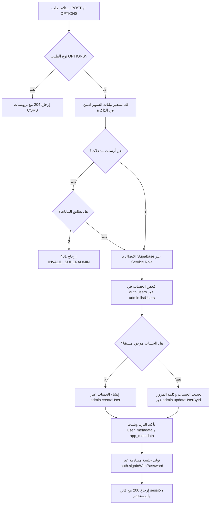

# دليل كتابة وهندسة دالة حساب السوبر أدمن (SuperAdmin Function Architecture Guide)
تاريخ الاعتماد: 2026-10-19 | النطاق: وكلاء الذكاء الاصطناعي (AI Agents) ومطورو المنظومات السحابية

---

## 1. الهدف والمفهوم الجوهري (Core Objective & Concept)

تُعد دالة السوبر أدمن (`<project_slug>.superadmin`) إحدى أهم دوال الحافة (Edge Functions) في منظومات Supabase المركزية. وظيفتها الأساسية هي **تهيئة وتوثيق حساب الإدارة العليا (Super Administrator) برمجياً وبشكل آمن تماماً**، مع منحه كامل الصلاحيات والامتيازات الإدارية على النظام، **دون أن يظهر الحساب إطلاقاً في واجهات الاستخدام أو دليل الموظفين أو الهيكل التنظيمي**.

### 🌟 القاعدة الذهبية الإلزامية (The Golden Rule)
> **الحساب ينشأ ويبقى في جدول التوثيق المركزي (`auth.users`) حصراً.**  
> **يُمنع منعاً باتاً إنشاء أو إدراج أي سجل لهذا الحساب في جداول الكادر أو الموظفين أو المستخدمين العاديين (مثل `core_university.staff_profiles` أو ما يقابلها في أي نظام).**  
> الهدف من ذلك هو بقاء الحساب غير مرئي تماماً في شاشات العرض والدليل العام، مع امتلاكه صلاحيات غير مقيدة عبر منظومة RLS والواجهة.

---

## 2. الهيكلية المعمارية والتسمية (Naming & Directory Structure)

يجب الالتزام بالهيكل المعزول المعتمد في الخادم المشترك:

```text
supabase/functions/
├── <project_slug>-router.ts                      <-- موجه المشروع المعزول
└── <project_slug>/                               <-- مجلد المشروع الرئيسي (سكيما المشروع)
    ├── project.json                              <-- وثيقة عقد دوال المشروع
    ├── <project_slug>.superadmin/                <-- مجلد الدالة الأساسية
    │   └── index.ts                              <-- كود الدالة وتشفير البيانات وتوليد الجلسة
    ├── <project_slug>.create_superadmin/         <-- نقطة دخول بديلة مطابقة
    │   └── index.ts                              <-- يعيد تصدير المعالج handler
    └── tests/
        └── superadmin_test.ts                    <-- اختبارات الوحدة وفك التشفير
```

### متطلبات التسمية:
1. مجلد الدالة الأساسي: `<project_slug>.superadmin` (مثال: `core_university.superadmin` أو `tablesystem.superadmin`).
2. مجلد الدالة البديل: `<project_slug>.create_superadmin` لضمان توافق النداءات القديمة والحديثة.
3. تسجيل الدالتين في ملف [`project.json`](file:///d:/projects/Core-University-Architecture/supabase/functions/core_university/project.json):
```json
{
  "operation": "superadmin",
  "method": "POST",
  "auth": "public"
},
{
  "operation": "create_superadmin",
  "method": "POST",
  "auth": "public"
}
```

---

## 3. معمارية التشفير وحماية البيانات (In-Memory XOR Cipher)

يُحظر كتابة بيانات الاعتماد (البريد، كلمة المرور، الاسم) كنصوص واضحة داخل الكود. يتم تشفيرها وتخزينها كسلاسل `Base64` وتفك في الذاكرة عبر خوارزمية `XOR`:

### نموذج التنفيذ:
```typescript
// مفتاح التشفير الخاص بالنظام في الذاكرة
const CIPHER_KEY = 'ALZAHRAWI_<PROJECT_SLUG_UPPER>_SUPERADMIN_SECRET_KEY_2026';

// نصوص مشفرة للبيانات: الإيميل، كلمة المرور، الاسم
const CIPHER_EMAIL = '...'; // Base64 مشفر بـ XOR
const CIPHER_PASS = '...';  // Base64 مشفر بـ XOR
const CIPHER_NAME = '...';  // Base64 مشفر بـ XOR

function decryptString(b64: string): string {
  const binary = atob(b64);
  const keyBytes = new TextEncoder().encode(CIPHER_KEY);
  const out = new Uint8Array(binary.length);
  for (let i = 0; i < binary.length; i++) {
    out[i] = binary.charCodeAt(i) ^ keyBytes[i % keyBytes.length];
  }
  return new TextDecoder().decode(out);
}
```

### دعم المدخلات الاختيارية:
- في حال استدعاء الدالة بطلب `POST` فارغ، تقوم فوراً بتوليد/مزامنة وتوثيق الحساب بناءً على البيانات المشفرة الافتراضية.
- في حال تمرير `email` و `password` في الجسم، يتم التحقق منهما بعد تنظيف السلسلة (`trim`, `toLowerCase`, إزالة البادئات مثل `-_`). إذا لم تتطابق، يُرفض الطلب فوراً برمز `401 INVALID_SUPERADMIN`.

---

## 4. دورة حياة التنفيذ البرمجي (Execution Lifecycle)

عند تنفيذ الدالة، يجب اتباع الخطوات الدقيقة التالية بالترتيب:



### التفاصيل التقنية للخطوات:

1. **التحقق من المستخدم في `auth.users`:**
   ```typescript
   const { data: usersList, error: listErr } = await client.auth.admin.listUsers({ page: 1, perPage: 1000 });
   let superUser = usersList.users.find(u => u.email?.toLowerCase() === targetEmail.toLowerCase());
   ```

2. **إنشاء الحساب مع تأكيد البريد المباشر والبيانات الوصفية:**
   ```typescript
   const adminMeta = {
     role: 'admin',
     is_super_admin: true,
     name: targetName,
     name_ar: targetName,
     name_en: 'Super Admin',
   };

   if (!superUser) {
     const { data: created, error: createErr } = await client.auth.admin.createUser({
       email: targetEmail,
       password: targetPassword,
       email_confirm: true, // تفعيل وتأكيد فوري بدون إرسال بريد
       user_metadata: adminMeta,
       app_metadata: { role: 'admin', is_super_admin: true },
     });
     // معالجة حالة التزامن إذا كان الحساب سُجل في نفس اللحظة
     superUser = created?.user ?? (await refetchUser());
   }
   ```

3. **المزامنة والتحديث الدائم:**
   إذا كان الحساب موجوداً، يتم استدعاء `client.auth.admin.updateUserById` للتأكد من أن كلمة المرور، وحالة تأكيد البريد، والحقول الوصفية (`is_super_admin: true`) محدثة دائماً ومطابقة لأحدث إعداد.

4. **توليد جلسة الدخول وتوثيقها:**
   ```typescript
   const { data: authSession, error: signInErr } = await client.auth.signInWithPassword({
     email: targetEmail,
     password: targetPassword,
   });
   ```

5. **الاستجابة القياسية:**
   إرجاع كائن الاستجابة المتوافق:
   ```json
   {
     "success": true,
     "message": "تم إنشاء وتوثيق حساب superAdmin بنجاح في المنظومة",
     "user": {
       "id": "uuid-here",
       "email": "superadmin@domain.com",
       "name": "superAdmin",
       "nameAr": "superAdmin",
       "nameEn": "Super Admin",
       "role": "admin",
       "isSuperAdmin": true
     },
     "session": { ... }
   }
   ```

---

## 5. تكامل الصلاحيات وقاعدة البيانات (Database & RLS Integration)

بما أن حساب السوبر أدمن لا يملك صفاً في جداول الكادر، يجب أن تتعرف عليه سياسات أمان قاعدة البيانات (RLS) ودوال التحقق من خلال **بيانات رمز المصادقة (JWT Claims)**.

### الدوال الواجب تحديثها في ملف ترحيل SQL:

1. **دالة الكاتب الموثوق (`core_university.is_trusted_writer`):**
   ```sql
   CREATE OR REPLACE FUNCTION core_university.is_trusted_writer() RETURNS boolean
   LANGUAGE sql STABLE SET search_path = pg_catalog, public, extensions AS $$
    SELECT current_setting('role', true) IN ('service_role', 'postgres', 'supabase_admin')
    OR (COALESCE(current_setting('role', true), 'none') = 'none'
        AND session_user IN ('postgres', 'supabase_admin'))
    OR COALESCE((auth.jwt()->'user_metadata'->>'is_super_admin')::boolean, false) = true
    OR COALESCE((auth.jwt()->'app_metadata'->>'is_super_admin')::boolean, false) = true;
   $$;
   ```

2. **دوال فحص صلاحيات الوحدات والتدقيق والتفويض (`has_unit_access`, `can_read_audit`, `can_delegate`):**
   يجب إضافة الشرط التالي في بداية التحقق:
   ```sql
   SELECT auth.uid() IS NOT NULL AND (
    COALESCE((auth.jwt()->'user_metadata'->>'is_super_admin')::boolean, false) = true
    OR COALESCE((auth.jwt()->'app_metadata'->>'is_super_admin')::boolean, false) = true
    OR EXISTS ( ... الفحص التقليدي عبر جداول الكادر والتكليفات ... )
   );
   ```

---

## 6. تكامل الواجهة الأمامية ولوحة التحكم (Frontend & UI Integration)

1. **استخراج صفة السوبر أدمن عند جلب مساحة العمل:**
   في خدمة مستودع البيانات (مثل [`universityRepository.ts`](file:///d:/projects/Core-University-Architecture/src/services/universityRepository.ts)):
   ```typescript
   const isSuperAdmin = Boolean(
     user.user_metadata?.is_super_admin ||
     user.app_metadata?.is_super_admin ||
     user.user_metadata?.role === 'admin'
   );
   return parseData(WorkspaceDataSchema, { ..., isSuperAdmin });
   ```

2. **السماح بالعمليات في دالة فحص الصلاحيات `can()`:**
   في نموذج مساحة العمل (مثل [`model.ts`](file:///d:/projects/Core-University-Architecture/src/components/dashboard/model.ts)):
   ```typescript
   export function can(data: WorkspaceData, permission: string, unitId?: string | null): boolean {
     // إذا كان المستخدم سوبر أدمن، يتم منحه الصلاحية الكاملة فوراً دون اشتراط وجود سجل كادر
     if (data.isSuperAdmin) return true;

     if (!data.currentStaff || data.currentStaff.employment_status !== 'active') return false;
     // ... بقية التحقق للكادر العادي
   }
   ```

3. **حماية دليل الكادر والهيكل التنظيمي:**
   لا تتأثر جداول الكادر أو شجرة الهيكل لأن الحساب لم يُدرج أصلاً في قاعدة البيانات المحلية، وبالتالي لن يظهر في أي جدول أو قائمة منسدلة أو إحصائية للموظفين.

---

## 7. قائمة التحقق الإلزامية لوكلاء الذكاء (Strict Agent Checklist)

قبل اعتبار مهمة السوبر أدمن مكتملة، يجب التحقق من الآتي:

- [ ] **ترويسة السطر الأول الإلزامية:** وجود السطر التالي كأول سطر في كل ملف جديد:
  `// يجب قراءة ملف قواعد كتابة الكود قبل كتابة أي سطر في الملف`
- [ ] **سقف الأسطر (Max 300 Lines):** جميع الملفات أقل من 300 سطر بنسبة 100%، وخالية من تحذيرات تجاوز 230 سطراً.
- [ ] **عدم المساس بالمشاريع الأخرى:** منع تعديل أي ملف خارج سكيما المشروع المطلوب (مثل عدم لمس `tablesSystem`).
- [ ] **عزل الحساب عن جداول الكادر:** التأكد من عدم وجود أي استعلام `insert` يضيف السوبر أدمن لجدول الموظفين أو الكادر.
- [ ] **إنشاء نقطة الدخول البديلة (`create_superadmin`):** إعادة تصدير نفس المعالج.
- [ ] **تسجيل الدالتين في `project.json`:** توثيق العمليتين ضمن قائمة `functions`.
- [ ] **كتابة اختبارات الوحدة:** وجود ملف `superadmin_test.ts` يفحص التشفير، ومعالجة `OPTIONS`، ورفض `GET`، ورفض المدخلات الخاطئة.
- [ ] **نجاح جميع الفحوصات الآلية:**
  - `npm run check:headers`
  - `npm run check:lines`
  - `node scripts/run-edge-tests.mjs`
  - `npm test`
  - `npm run build`
